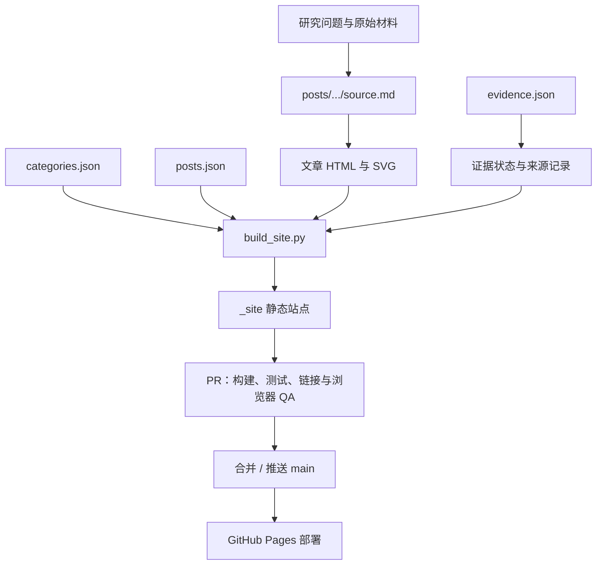

# Thinking Atlas · 思考图谱

**从直觉到机制，从观点到证据。**

Thinking Atlas 是一个持续演进的研究型知识库，围绕制度与权力、历史机制、经济与商业、技术与社会、社会与家庭、研究方法及个人系统，整理可追溯、可质疑、可修订的专题研究。

它不是观点摘录集，也不把未经核实的网络叙事包装成结论。每个主题都应尽可能回答四个问题：**我们知道什么、证据来自哪里、机制如何成立、什么证据可能推翻当前解释。**

[](https://github.com/1998x-stack/thinking-atlas/actions/workflows/publish.yml)

[阅读网站](https://1998x-stack.github.io/thinking-atlas/) · [知识地图](https://1998x-stack.github.io/thinking-atlas/topics/) · [文章归档](https://1998x-stack.github.io/thinking-atlas/archive/) · [研究方法](https://1998x-stack.github.io/thinking-atlas/methodology/) · [RSS 订阅](https://1998x-stack.github.io/thinking-atlas/feed.xml) · [Agent 协作规范](AGENTS.md)

> **重要：公开状态不等于证据状态。** `published` 只表示文章进入公开网站；`research_status` 才表示研究核验程度。研究提纲、部分核验文章可以公开阅读，但不能因此被引用为已经证实的事实。

## 项目原则

1. **Evidence first**：先确定可检验的问题，再形成判断；不把用户陈述、网络热帖或作者直觉直接当作事实。
2. **Primary sources first**：优先使用法律法规原文、政府公告、司法文书、统计原表、历史文献、论文及机构一手数据。
3. **Adversarial verification**：主动寻找反例、相反材料、竞争解释、统计口径差异和来源依赖。
4. **Traceability**：重要主张应能追溯到来源、发布时间、事件时间、具体章节/条款/表格及适用范围。
5. **Uncertainty awareness**：明确区分事实、推论、假设与未知；证据不足时保留不确定性。
6. **Revision over certainty**：新证据可以修订旧结论；保留来源、状态与必要的修订痕迹。
7. **Explain mechanisms, not just opinions**：用变量、约束、激励、因果路径和边界条件解释问题，不用漂亮图表替代证据。

## 当前内容基线

以下数字来自当前研究分支的内容注册表与 2026-11-22 内容审计，不代表对全部主题完成了独立研究，也不是实时访问统计。

| 指标 | 当前基线 |
| --- | ---: |
| 公开文章 | 24 |
| 一级研究领域 | 7 |
| 二级研究主题 | 20 |
| 部分核验（`partial`） | 18 |
| 研究提纲（`outline`） | 6 |
| 全面核实（`verified`） | 0 |

**当前没有被标记为 `verified` 的文章。** 这不是质量缺陷的掩饰项，而是对现阶段证据成熟度的明确披露。页面重构、迁移、图示完善或网站成功部署，都不能自动提升研究状态。

## 从哪里开始阅读？

### 网站入口

| 入口 | 用途 |
| --- | --- |
| [首页](https://1998x-stack.github.io/thinking-atlas/) | 精选专题、领域导航、全文索引与搜索 |
| [知识地图](https://1998x-stack.github.io/thinking-atlas/topics/) | 按一级领域与二级主题发现研究 |
| [文章归档](https://1998x-stack.github.io/thinking-atlas/archive/) | 按更新时间浏览公开文章 |
| [研究方法](https://1998x-stack.github.io/thinking-atlas/methodology/) | 了解证据边界、核验原则与研究限制 |
| [RSS Feed](https://1998x-stack.github.io/thinking-atlas/feed.xml) | 在 RSS 阅读器中订阅公开文章 |

### 研究领域

| 领域 | 研究范围 |
| --- | --- |
| [制度与权力](posts/institutions/) | 劳动制度、资源配置、公共服务外包、组织人事与干部任用 |
| [历史机制](posts/history/) | 可信承诺、权力交接与财政改革比较 |
| [经济与商业](posts/economics/) | 经济测量、公共财政、城市经济、消费结构、商业模式、资产定价与投机 |
| [技术与社会](posts/technology/) | 技术替代、依赖关系与资源入口迁移 |
| [社会与家庭](posts/society/) | 社会规范、家庭制度、教育与身心健康、养老保险与社会保障 |
| [研究方法](posts/methods/) | 证据、模型、博弈分析、反证与认知修订 |
| [个人系统](posts/life/) | 能力、行动、风险、退出选择与长期适应 |

### 推荐阅读起点

以下为现有文章入口，不构成研究结论排名：

- [中国劳务派遣：三方用工中的控制权、成本与责任](posts/institutions/labor-dispatch/index.html) — 法律条文、用工控制权与责任边界。
- [高平陵之变与洛水之誓：何谓可信承诺？](posts/history/credible-commitment/index.html) — 区分史料叙事、制度机制与反事实边界。
- [真实经济活动：多指标交叉验证](posts/economics/real-activity/index.html) — 讨论指标生成约束、代表性与因果识别边界。
- [资源入口、依赖关系与权力转移](posts/institutions/resource-gates/index.html) — 用稀缺性、排他性、替代性和问责性分析资源控制。
- [从信息堆叠到可检验的问题模型](posts/methods/evidence-and-models/index.html) — 以问题、变量、机制、反证和边界组织研究。
- [个人适应系统：能力、作品、关系和选择权](posts/life/adaptive-system/index.html) — 分析个人行动中的约束、风险与退出选择。
- [日本长期停滞与逆势产业：消费结构迁移、零售革命及中国的适用边界](posts/economics/japan-consumption-reallocation/index.html) — 区分名义销售额、真实销量与利润，识别消费结构迁移。
- [金融危机的两阶段资产定价：流动性冲击、偿付能力损失与资产角色](posts/economics/financial-crisis-liquidity-and-assets/index.html) — 解释现金、黄金、股票和债券在不同危机阶段的功能。
- [12345政务热线的外包治理：上海、北京、深圳的预算、人员、绩效与责任链](posts/institutions/12345-hotline-outsourcing-governance/index.html) — 核验预算、席位、员工工资和政府责任边界。
- [中国教育竞争与学生身心健康：江苏高中作息改革、睡眠证据与自杀统计的因果边界](posts/society/education-workload-sleep-and-wellbeing/index.html) — 区分政策事实、睡眠证据和死亡统计口径。
- [博弈论与组织权力：九种经典博弈、收益矩阵及职场和历史案例](posts/methods/game-theory-and-organizational-power/index.html) — 用矩阵解释组织激励、信号、承诺和合作困境。

**完整文章清单以 [`content/posts.json`](content/posts.json) 为准**；分类与稳定主题标识以 [`content/categories.json`](content/categories.json) 为准。README 中的推荐入口只用于导航，不是第二份内容注册表。

## 证据与状态模型

项目将“是否公开”与“研究是否核实”分成两个独立字段，任何 Agent、编辑或贡献者都不得混用。

### 发布状态：`status`

| 值 | 含义 |
| --- | --- |
| `draft` | 内部草稿，不进入公开首页、归档、RSS 或 Sitemap |
| `published` | 允许公开阅读；不代表研究结论已经充分核实 |

### 研究状态：`research_status`

| 值 | 页面标记 | 使用条件 |
| --- | --- | --- |
| `verified` | 已核实 | 核心主张有可定位的可靠证据，适用范围、反证与限制已记录 |
| `partial` | 部分核验 | 已核实部分事实或材料，但核心主张、代表性或因果解释仍有缺口 |
| `outline` | 研究提纲 | 主要用于保存问题、候选机制和研究路径，尚未完成足够的独立核验 |

每篇文章的 `evidence.json` 记录原始来源路径、迁移信息、研究状态、来源链接、核验限制和下一步行动。证据台账是研究记录，不是“引用数量证明”。多个网站转载同一来源不构成多个独立证据；官方来源也需要核对其具体语境、口径和适用范围。

研究报告中应把内容分为：

- **FACT**：可由明确来源支持、适用范围清楚的事实。
- **INFERENCE**：由事实和机制推导出的解释，说明推理步骤。
- **HYPOTHESIS**：尚未得到充分验证的候选解释。
- **UNKNOWN**：现有资料不足以判断的问题。

更完整的原则见 [编辑与证据规范](docs/EDITORIAL.md)、[内容质量审计](docs/CONTENT_AUDIT.md) 和 [原始资料覆盖说明](docs/source-coverage.md)。

## 内容与工程架构

项目采用清单驱动的静态出版架构：内容源文件保留在仓库中，构建脚本生成面向读者的静态网站。分类、文章元数据、页面、证据和共享前端资源各有明确的数据所有权。

```text
thinking-atlas/
├── README.md
├── AGENTS.md                         # 完整的仓库级 Agent 协作契约
├── content/
│   ├── categories.json               # 一级领域与二级主题的唯一数据源
│   └── posts.json                    # 文章元数据、发布状态与研究状态
├── posts/<category>/<slug>/
│   ├── index.html                    # 正式文章 HTML 源文件
│   ├── source.md                     # 迁移保留的可编辑研究底稿
│   ├── evidence.json                 # 来源、核验状态、限制与后续行动
│   └── assets/*.svg                  # 文章专属机制图
├── site/assets/                      # 全站 CSS、JavaScript 与图标
├── scripts/
│   ├── build_site.py                 # 静态网站构建
│   ├── validate_site.py              # 注册表、源文件、链接与发布产物校验
│   ├── browser_check.py               # Playwright 桌面/移动端浏览器 QA
│   └── sync_skills.py                # 同步与校验 Skill 镜像
├── skills/olah-style-paper-posts/    # Canonical 教学写作 Skill
├── .agent/ .claude/ .opencode/ .pi/  # 四套 Agent Skill 镜像
├── docs/                             # 架构、编辑、审计与来源覆盖文档
├── tests/                            # 当前自动化测试
├── .github/workflows/publish.yml     # PR 验证与 main 分支 Pages 发布
└── _site/                            # 构建生成目录，禁止提交
```

### 数据所有权

| 路径 | 职责 | 修改原则 |
| --- | --- | --- |
| `content/categories.json` | 分类、领域描述、二级主题和稳定 slug | 优先复用已有主题；公开 slug 原则上不变 |
| `content/posts.json` | 文章标题、摘要、分类、主题、日期、状态、标签和封面 | 每篇文章仅有一个主分类和一个主主题 |
| `posts/.../index.html` | 正式阅读页面 | 文章内容与结构的主要编辑入口 |
| `posts/.../source.md` | 迁移保留的研究底稿 | 保留来源语境，不将底稿本身视为证据 |
| `posts/.../evidence.json` | 来源路径、核验状态、限制与后续研究 | 与文章研究状态保持一致，不伪造核验记录 |
| `posts/.../assets/` | 文章专属图示 | 图示解释机制，不伪装成统计结果 |
| `site/assets/` | 全站样式、脚本和图标 | 只放跨页面共享资源 |
| `skills/olah-style-paper-posts/` | Skill 唯一正本 | 修改正本后同步四份镜像 |
| `_site/` | 静态构建输出 | 可删除、可重建，不手工编辑、不提交 |

### 构建与发布数据流



构建输出包括首页、知识地图、分类页、文章归档、研究方法页、公开搜索索引、RSS、Sitemap、robots.txt 和 404 页面。只有注册表中 `status: published` 的文章进入公开站点与 RSS。

## 本地开发与验证

要求 **Python 3.11+**。静态构建、基础校验和当前单元测试使用 Python 标准库；浏览器 QA 需要安装 Playwright 与 Chromium。

### 1. 构建和基础验证

在仓库根目录执行：

```bash
# 检查 canonical Skill 与四份 Agent 镜像是否一致
python scripts/sync_skills.py --check

# 生成静态网站到 _site/
python scripts/build_site.py

# 运行当前单元测试
python -m unittest discover -s tests -v

# 校验内容注册表、文章文件、SVG、内部链接、RSS 与 Sitemap
python scripts/validate_site.py

# 检查 Python 源码语法
python -m compileall -q scripts tests
```

### 2. 浏览器 QA

首次运行时安装开发依赖和 Chromium：

```bash
python -m pip install -r requirements-dev.txt
python -m playwright install chromium
python scripts/browser_check.py --output reports/browser
```

浏览器脚本会检查生成站点中的首页、知识地图、归档、研究方法页、分类页及已发布文章，覆盖 1440px 桌面、390px 手机和 360px 窄屏；同时检查图片加载、横向溢出、页面异常、首页搜索/状态筛选和基础键盘焦点，并输出截图与 `report.json`。

**未实际执行的检查必须标记为未验证。** 本地构建成功不代表浏览器 QA 成功；PR CI 成功也不代表 Pages 已部署。

### 3. 本地预览

```bash
cd _site
python -m http.server 8000
```

打开 <http://localhost:8000/>。生产站点部署在 GitHub Pages 的 `/thinking-atlas/` 子路径，内部链接使用相对路径。

### 4. 可选构建参数

```bash
python scripts/build_site.py --base-url https://example.org/research/ --archive-size 16
```

`--base-url` 控制规范 URL、RSS 和 Sitemap 的绝对地址；`--archive-size` 控制每页归档文章数。默认地址为项目 GitHub Pages 地址。不要为了本地预览修改生产链接。

## 新增或更新研究文章

当前仓库**没有**根目录级的 `scripts/new_post.py` 文章脚手架。请勿照搬其他仓库的命令或假设脚手架已经存在；新增文章时按以下流程手动创建并验证：

1. **定义问题与边界**：写明研究对象、地区、时间、制度/法律版本、核心概念及要回答的问题。
2. **选择分类**：优先复用 `content/categories.json` 中已有的 `category` 和该分类下的 `topic`；只有存在稳定、可解释的新知识领域时才增加分类。
3. **创建文章目录**：建立 `posts/<category>/<slug>/`，至少包含 `index.html`、`source.md`、`evidence.json` 和文章专属 `assets/*.svg`。
4. **登记文章**：在 `content/posts.json` 中增加唯一 slug 的元数据。先设为 `status: draft`；填写真实的 `published`、`updated` 日期、标题、摘要、阅读时间、分类、主题、标签，以及本文章的 `cover.src` 和具体、独特的 `cover.caption`。
5. **建立证据记录**：`evidence.json` 的 `research_status` 必须与注册表一致；保留 `source.original_path` 等来源溯源信息。只有真实完成独立核验时，才记录核验完成及对应的已核实主张。
6. **完成质量门禁**：构建、测试、站点校验、浏览器 QA 和人工来源复核均通过后，再决定是否将 `status` 改为 `published`。
7. **提交 PR**：说明研究新增内容、证据变化、反证与局限、运行过的检查及未完成事项。

不要为了让首页看起来更丰富而创建虚构文章、占位结论或重复主题。发布状态、研究状态、来源日期和文章更新时间必须分别准确。

## Olah-style Skill 集成

本仓库将 [Olah-style-posts](https://github.com/1998x-stack/Olah-style-posts) 的渐进式解释、原创图示、语义 HTML 与浏览器 QA 方法集成到 `skills/olah-style-paper-posts/`。

- 正本：`skills/olah-style-paper-posts/`。
- 镜像：`.agent/skills/`、`.claude/skills/`、`.opencode/skills/`、`.pi/skills/`。
- 修改正本后执行 `python scripts/sync_skills.py`，并以 `python scripts/sync_skills.py --check` 验证。
- 不要直接编辑镜像，也不要让不同 Agent 维护不同版本的规则。
- 机器学习论文的张量、公式和实验章节不能机械套用于历史、制度、法律、经济或社会研究；这些主题应使用原始档案、法规、裁判文书、统计原表、史料与反证来完成相应的证据工作。

## CI、部署与生产状态

[`publish.yml`](.github/workflows/publish.yml) 在 Pull Request、推送到 `main` 和手动触发时运行验证工作流。当前工作流包括 Python 编译检查、Skill 镜像一致性检查、静态构建、单元测试、站点校验及 Playwright 浏览器 QA，并上传浏览器报告 Artifact。

- **Pull Request**：执行验证，不部署网站。
- **推送到 `main`**：验证通过后，上传静态站点 Artifact 并部署 GitHub Pages。
- **生产验收**：必须检查 Actions 中的部署 Job 成功，并确认公开页面、文章链接和 RSS 可访问。仅有本地构建、提交成功或 PR CI 通过，都不能表述为“已上线”。

如页面没有更新，按顺序检查提交是否已进入 `main`、验证 Job、部署 Job、Pages 环境和公开 URL；不要用本地状态替代线上证据。

## 项目文档

| 文档 | 内容 |
| --- | --- |
| [`AGENTS.md`](AGENTS.md) | Agent 工作契约、研究流程、工程规则与验收清单 |
| [`docs/ARCHITECTURE.md`](docs/ARCHITECTURE.md) | 架构、构建数据流、迁移与发布边界 |
| [`docs/EDITORIAL.md`](docs/EDITORIAL.md) | 编辑原则、证据状态与研究表达规范 |
| [`docs/CONTENT_AUDIT.md`](docs/CONTENT_AUDIT.md) | 截至 2026-11-21 的逐主题质量审计与证据缺口 |
| [`docs/source-coverage.md`](docs/source-coverage.md) | 初始材料覆盖范围、来源限制与检索边界 |
| [`skills/olah-style-paper-posts/SKILL.md`](skills/olah-style-paper-posts/SKILL.md) | 渐进式解释、图示、页面和浏览器 QA 方法 |

## 隐私、来源与许可

这是一个公开仓库。不得提交私人聊天原文、账号凭据、个人联系方式、精确住址、敏感个人信息、未经证实的个人指控，或不具备再发布许可的第三方长文、图片、图表和代码。涉及公共人物与公共事务时，只讨论可核验的公开行为和记录；不能把履历关联、时间先后或推测性动机写成已证实事实。

项目借鉴的是教学组织与工程方法，不复制 Christopher Olah、Harvard NLP 或其他作者的原文、图像和代码。**当前仓库未发现根目录 `LICENSE` 文件，因此不要推断项目内容已经授予某种开源再利用许可。** 在许可明确前，引用第三方资料应遵守原始来源的版权和使用条件。

---

**维护原则：** 让知识结构可以扩展，让证据链可以复核，让每个结论都保留被修订的可能。
