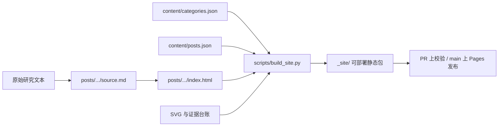

# 重构架构与迁移台账

## 三仓职责
- `xm-posts`：参考其 `content/categories.json`、`content/posts.json`、`posts/<category>/<slug>/`、`site/assets/`、`scripts/`、`tests/`、GitHub Pages 和 Skill 同步组织方式。
- `thinking-atlas`：研究对象与唯一内容归属；不把 AI 机器学习文章混进本站，也不复制无关测试或产品功能。
- `Olah-style-posts`：原始教学 Skill 的设计背景；本站以 `xm-posts` 中更新的 canonical Skill 为迁移基准。

## 构建数据流

站点根路径是 `/thinking-atlas/`，首页 `/`，知识地图 `/topics/`，分类 `/categories/<slug>/`，归档 `/archive/`，正式文章 `/posts/<category>/<slug>/`。交互搜索使用构建生成的 `posts.json`；RSS 使用固定 GUID、日期精度与 Atom self-link；不依赖服务器或客户端框架。

## 状态模型
- `status`：`published` 或 `draft`，决定是否对外显示。
- `research_status`：`outline` 研究问题/草稿，`partial` 存在可归档材料但独立验证不足，`verified` 核心主张逐项证据核验完成。
- 任何 `partial` 或 `outline` 文章须在首屏明确提醒；不能把图示说成实证。

## 删除与保留
迁移应保留核心知识全文至 source.md，HTML 为新版编辑页面；`sources/`、`meta/`、`weekly/`、`questions/`、`templates/` 中具有来源/方法价值的文件移至 `docs/legacy/` 后再删除旧目录，不发布隐私数据。
不得把文件名错置的旧上传材料当作已核实人物研究；该问题须在来源覆盖声明保留。

## 生成物与风险
只将注册的 published 文章、SVG、共享静态资源与生成导航发布到 GitHub Pages。源 MD、evidence JSON、Skill 和内部流程文档不部署到网站；可在仓库查阅。建立 CI 门禁覆盖注册表、断链、可访问性、RSS XML 和 sitemap。
