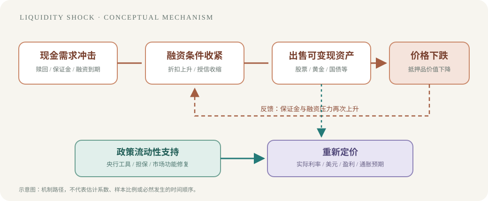
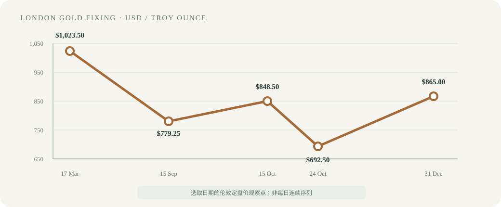
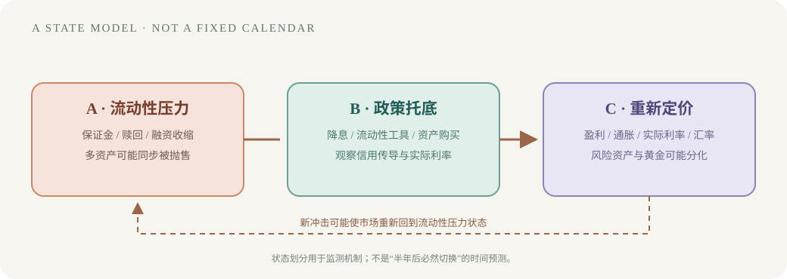

# 金融危机中的资产配置：流动性冲击、黄金避险与危机择时

> 核心问题：金融危机是否真的存在一个“先持有现金、后转向黄金和股票”的固定顺序？黄金与股票的相对走势，能否告诉我们危机处于哪个阶段？

**研究状态：部分核验（partial）**  
**研究基准日：2026-11-21**  
**分类：经济与商业 / 资产定价与投机**

## 结论先行

这段市场叙事抓住了一个真实机制：当融资链条断裂、投资者遭遇保证金追缴或赎回压力时，市场参与者可能出售最容易变现的资产筹集现金。黄金、股票，甚至通常被视为安全资产的美国国债，都可能在极端流动性冲击中与风险资产同步下跌。

但它把这个机制过度简化成了固定的“上半场／下半场”排名。历史数据也不支持“雷曼倒闭当月黄金从约1,030美元跌到680美元”的时间说法：伦敦黄金定盘价约1,023.50美元出现在2008年3月17日；2008年9月15日雷曼申请破产当天约为779.25美元；10月15日约为848.50美元；10月24日才到约692.50美元。春季高点到秋季低点的回撤约32.3%，但雷曼倒闭后一个月的这组定盘价并未下跌，反而上涨约8.9%。[S1]

另一个关键反证是：世界黄金协会按LBMA黄金价格口径统计，黄金2008年全年仍录得约4.3%的正收益，年末价格约869.75美元/盎司。危机中某几天或某几周的抛售，不等于黄金全年表现为负。[S2]

因此，更稳健的结论不是“上半场现金、下半场黄金”，而是：**先判断自己面对的是流动性风险、偿付能力风险，还是购买力风险；再判断政策、实际利率、美元、信用和盈利如何变化。** 黄金与股票的分化可以作为观察变量，但不能单独充当危机阶段的发令枪。

## 1. 一个反直觉的问题：为什么避险资产也会在危机里下跌？

黄金的长期组合功能与危机某个交易日的价格表现，是两个不同问题。

当市场平稳时，黄金可能发挥分散风险、对冲货币购买力变化和应对尾部事件的作用。但当机构必须在当天补保证金、应对赎回或偿还短期融资时，它首先需要的是可交割、可支付的现金，而不是一项长期看起来有价值的资产。

世界黄金协会2020年3月19日的市场评论指出，黄金在当时仍是高流动性资产，3月日均交易额超过2,600亿美元；在跨资产大规模清算、杠杆仓位和规则化交易共同作用下，黄金也可能被出售以筹集现金。该文同时指出，黄金ETF当月资金流入仍为正，说明“价格下跌”和“投资者全面撤离黄金”并不是同一件事。[S3]

2020年3月的市场压力还波及美国国债。美联储记录到，投资者大量出售长期国债和机构MBS，转向短期限、更具流动性的资产；长期国债收益率在3月中旬反常上升，国债和MBS买卖价差显著扩大。[S4] BIS对2020年3月的回顾也记录了美国优质货币市场基金赎回、杠杆投资者为满足保证金要求而平仓，以及美国国债等多类资产同步承压。[S5]

这不是“黄金失去了避险属性”的充分证据，而是说明：**在无序清算阶段，资产的即时可变现性可能压过其长期避险属性。**

## 2. 先把三种风险分开

### 2.1 流动性风险：有资产，但不能及时变成钱

流动性风险关心的是：需要支付时，资产能否在合理时间内、以合理价差变成可用资金。

典型情形包括：
- 基金遭遇集中赎回，需要快速出售证券；
- 杠杆投资者遭遇追加保证金，被迫平仓；
- 回购融资方提高抵押品折扣或拒绝续作；
- 房地产买家减少、按揭审批收紧，挂牌房屋成交周期拉长。

### 2.2 偿付能力风险：资产价值不足以覆盖负债

偿付能力风险关心的是：资产负债表最终是否有能力覆盖债务。房价下跌本身不等于立即违约；但如果家庭同时遭遇收入中断、较高杠杆和刚性月供，账面损失就可能转化为现金流危机或违约。

### 2.3 购买力风险：名义现金还在，实际购买力下降

现金没有明显的市场报价波动，但它并非没有风险。通胀、汇率变化、存款机构信用、存款保险覆盖范围和支付渠道风险，都可能影响现金的真实安全性。

所以，“现金为王”更准确的意思是：在不确定性急剧上升时，优先保证短期支付能力，保有高质量、可及时支取、币种与近期负债相匹配的流动性资产。它不意味着所有名为“现金管理”的产品都等同于银行存款，也不意味着现金能永久保值。

### 2.4 机制图：流动性冲击如何演变为资产同步下跌

图示是机制解释，不是某次危机的实测因果估计。资产价格下跌会降低抵押品价值；融资收紧、保证金和赎回要求又迫使机构出售资产；出售压力反过来压低价格，形成顺周期反馈。黄金可能因为流动性好而被出售，但也可能因为实际利率下降、美元走弱或避险需求上升而重新受到支持。

## 3. 2008年黄金：真实回撤与错误时间线

### 3.1 用同一报价口径重建时间线

下表采用Westmetall公布的2008年伦敦黄金定盘价。它不是COMEX期货盘中最高／最低价，也不是所有数据商的现货收盘价，因此比较时必须保持同一口径。[S1]

| 日期 | 伦敦黄金定盘价（美元/盎司） | 说明 |
|---|---:|---|
| 2008-03-17 | 1,023.50 | 春季高点附近 |
| 2008-09-15 | 779.25 | 雷曼申请破产当天 |
| 2008-09-30 | 897.00 | 9月末观察点 |
| 2008-10-15 | 848.50 | 雷曼事件约一个月后 |
| 2008-10-24 | 692.50 | 秋季低点 |

按表内端点计算：
- 2008年3月17日至10月24日：约下跌32.3%；
- 2008年9月15日至10月15日：约上涨8.9%；
- 2008年9月15日至10月24日：约下跌11.1%。

所以，原文把春季约1,023.50美元的高点与10月24日约692.50美元的低点拼接成“雷曼倒闭当月一个月跌掉三分之一”，时间范围不成立。更严谨的说法是：黄金在2008年春季冲高后，随后数月经历了明显回撤；在雷曼倒闭前后，价格路径并不是单边下跌。

### 3.2 更重要的反证：2008年黄金全年仍上涨

世界黄金协会在2020年回顾中指出，黄金在2008年最紧张的抛售日也曾与风险资产同步下跌；但按LBMA黄金价格口径，黄金2008年全年回报约为+4.3%，年末约869.75美元/盎司。[S2]

这组数据提醒我们至少要区分三种收益：
1. 峰值到谷值的最大回撤；
2. 某个危机窗口内的阶段收益；
3. 日历年度的总收益。

选择不同起点和终点，可能得到方向不同的结论。用一个阶段的最大回撤描述全年表现，是典型的窗口选择偏差。

### 3.3 股票的案例也要限定指数

上海证券交易所历年指数资料显示，上证综合指数2007年最高点为6,124.04点（10月16日），2008年最低点为1,664.93点（10月28日），按两个极值计算回撤约72.8%。[S6]

这能说明中国A股在该区间经历了极端下跌，但不能直接等同于全球股票市场，也不能代表每个投资者的实际收益。价格指数、含分红总回报指数、计价货币和持有窗口不同，都会改变跨资产比较结果。

## 4. 2020年3月：黄金、国债都可能被“卖成现金”

世界黄金协会2020年3月19日的同期评论，将黄金与股票同步下跌解释为大规模清算、杠杆仓位和规则化交易共同作用的结果。其数据说明，当时黄金仍保持高流动性；黄金ETF在个别地区出现流出，但全球3月资金流仍为净流入。[S3]

同一时期，美联储观察到美国国债和机构MBS市场功能恶化：投资者出售长期证券、转向短期流动性资产，长期国债收益率在3月中旬出现反常上升，买卖价差扩大。[S4]

BIS进一步记录，2020年3月底美国优质货币市场基金遭遇约1,600亿美元赎回，约占相关基金资产的15%；与此同时，杠杆投资者被迫出售头寸满足保证金要求，抛售压力扩散至美国国债等资产。[S5]

因此，原文关于“黄金短期下跌、因为有人需要现金”的机制有证据支持；但“2020年两周跌12%”这个精确百分比，必须先确定现货还是期货、收盘还是盘中、起止日期和计价货币。本研究不把没有统一口径的12%写成已核实事实。

## 5. 房地产与现金：不能只看资产价格排名

### 5.1 房地产：价格下跌不等于成交流动性同步变化

S&P/Case-Shiller资料显示，美国全国房价指数从2006年7月峰值184.62降至2012年2月低点134.01，峰谷下跌27.4%；20城市综合指数从206.52降至134.07，约下跌35.1%。[S7]

这是价格指数的证据，不是每套房子的成交周期或折价率。房地产交易摩擦较高，卖方可能撤牌或延迟承认损失，导致成交量先下降、价格指数后调整。房产是否容易变现，还取决于区域就业、人口流入、户型、总价、租金现金流、按揭可得性和卖方是否有时间等待。

中国市场也不能用“全国房子都卖不出去”概括。国家统计局2026年1—10月数据表明，房地产开发投资同比下降21.6%，新建商品房销售面积下降13.7%，销售额下降14.3%；但同期二手住房网签交易面积同比增长11.4%。[S8] 这意味着开发端、新房和二手房交易表现并不完全一致。

2026年10月70个大中城市数据也显示明显分化：上海新建商品住宅价格指数同比为102.7（同比约上涨2.7%），而郑州为95.8、昆明为95.7。该指数是城市层面的统计调查结果，不能替代具体小区和房屋的成交分析。[S9]

### 5.2 现金不是单一工具

至少要区分：
- 银行存款：主要涉及银行信用、存款保险、支取和支付系统；
- 短期国库券：有到期结构和二级市场价格风险；
- 货币市场基金：是投资基金，底层证券和赎回安排决定风险；
- 银行理财或现金管理产品：不能仅凭产品名称认定为存款；
- 外币现金：还存在汇率与本币支出错配风险。

BIS对2020年3月的观察尤其重要：即使是货币市场基金，也可能遭遇赎回；即使是美国国债，也可能在市场中介能力不足和投资者集中出售时承压。[S5] “现金第一”必须说明是哪一种现金、由谁发行、何时可用，以及它是否与未来负债的币种和期限匹配。

## 6. 把“两半场”改成三个可观察状态

历史危机并不严格按照“先清算、后放水、再上涨”的时间表推进。2008年美联储在2007年9月已经开始降息；2008年10月8日六家央行协调降息，10月29日联邦基金利率目标降至1%；11月25日美联储宣布计划购买最多1,000亿美元机构债务和5,000亿美元机构MBS。[S10][S11]

政策响应是逐步展开的，不是某一天突然从“上半场”切换到“下半场”。市场也可能在政策落地之前提前定价，或在政策宽松后因盈利恶化、信用损失和通胀约束再次下跌。

### 状态A：融资与流动性压力

观察融资成本、保证金、基金赎回、回购市场、国债买卖价差和信用利差。若多个市场同时出现融资收缩和被迫出售，短期支付能力比预测某一资产底部更重要。

### 状态B：政策托底与重新定价

观察央行是否提供流动性工具、政策利率如何变化、实际利率和美元如何反应，以及信用市场是否恢复功能。政策宣布不等于资金已经传导到企业和家庭。

### 状态C：盈利修复、通胀与货币再定价

观察就业、企业盈利、信用扩张、实际利率、通胀预期和财政可持续性。此时黄金可能受实际利率和货币预期影响，股票可能受盈利和折现率影响，二者既可能反向，也可能同涨。

三个状态并非机械线性推进。新的融资冲击可能让市场从B重新回到A；通胀冲击也可能使政策宽松空间受限。

## 7. 黄金与股票“分家”：可以观察，不能单独择时

“股票跌、黄金涨”至少有多种解释：
- 实际利率下降、美元走弱；
- 避险需求上升；
- 央行购金、ETF资金流入；
- 地缘政治或本币汇率冲击。

“股票跌、黄金也跌”同样可能有多种解释：
- 美元现金需求上升、保证金追缴和去杠杆；
- 美元走强或实际利率上升；
- 黄金期货多头仓位拥挤，触发强制平仓；
- 其他资产亏损导致投资者出售黄金补充现金。

所以，相关性变化不是一个唯一因果信号。要把它变成可检验的择时策略，至少需要预先定义：
1. 黄金与股票采用什么指数和计价货币；
2. 使用日、周还是月频数据；
3. 观察20日、60日还是更长窗口；
4. “一起跌”和“反向走”的量化阈值；
5. 信号持续几天才触发；
6. 交易成本、税费、价差、停牌和滑点；
7. 样本内与样本外胜率、误报率、漏报率和最大回撤。

原始观点没有给出这些定义，也没有提供跨危机时期的回测。因此，目前只能把它视为经验叙事，不能视为经过验证的交易系统。

## 8. 2027年7—9月金融危机预测：风险存在，不等于可以精确择时

原文提出三个具体预测：2027年7—9月爆发全球金融危机、2027年9月黄金见底、2028年初开始放水。要检验这类预测，首先需要定义“全球金融危机”：是全球衰退、银行系统性危机、全球股市大幅回撤、主权债市场失灵，还是跨境美元融资冻结？不同定义对应不同数据和触发机制。

IMF 2026年10月《世界经济展望》的基准预测是全球经济2026年增长3.1%、2027年增长3.4%；同时强调冲突升级、AI预期重估、贸易紧张和财政脆弱性等下行风险。[S12] 这不是“危机不会发生”的保证，但也没有给出2027年第三季度危机的具体时间预测。

IMF 2026年10月《全球金融稳定报告》指出，金融市场截至报告分析时点仍有韧性，但金融稳定风险偏高；AI相关资产估值调整、主权债收益率冲击、网络风险，以及非银行金融机构的流动性错配和私募信贷杠杆，可能放大市场压力。[S13]

这两类材料支持“需要关注脆弱性”，不支持“已经知道危机发生月份”。要把月份预测提升为可评估研究，作者必须公开模型、输入数据、参数、历史回测、概率校准和失败记录。当前公开论证没有提供这些内容，所以该预测应标记为**未验证（unverified）**。

## 9. 更可执行的家庭风险管理框架

与其预测某个月份，不如先降低家庭在压力情景下被迫出售资产的概率。

### 9.1 先做现金流压力测试

- 列出未来12个月刚性支出：房贷、房租、教育、医疗、赡养、税费。
- 估算收入中断3、6、12个月时的现金缺口。
- 区分银行存款、货币基金、银行理财和短期债券，不以产品名称判断安全性。
- 确认近期负债与储备资金的币种一致。
- 不用短期必须支出的钱承担高波动风险。

### 9.2 再检查资产负债表

- 高杠杆家庭要先检查债务服务能力，而不是先猜黄金底部。
- 房产账面净值不能替代应急储备。
- 长期股票仓位不应由短期借款或未来一年必需支出支持。
- 黄金可以是分散配置的一部分，但不产生票息，实物买卖还存在价差、保管和变现渠道问题。
- 房地产要同时看成交量、挂牌库存、成交周期、租金、空置率和区域人口就业，而不是只看挂牌报价。

### 9.3 建立多指标风险仪表盘

| 维度 | 可观察指标 | 解释 |
|---|---|---|
| 融资压力 | 美元融资利差、回购利率、跨币种基差 | 是否出现融资收缩 |
| 市场流动性 | 买卖价差、市场深度、基金赎回 | 是否出现被迫出售 |
| 信用风险 | 高收益债利差、违约率、银行信用利差 | 是否从流动性传导到偿付能力 |
| 杠杆压力 | 保证金追缴、融资余额、抵押品折扣 | 是否存在强制去杠杆 |
| 宏观增长 | 就业、PMI、新订单、贸易和工业生产 | 金融冲击是否进入实体经济 |
| 黄金定价 | 实际利率、美元、ETF流量、期货净持仓 | 避险需求与仓位清算谁占主导 |
| 房地产 | 成交量、挂牌库存、成交周期、折价率 | 房屋是否真正难以变现 |

单一指标异常不能等同于金融危机。应观察多个相互独立的指标是否同时恶化，以及它们之间是否存在明确的传导链。

## 10. 最终结论与仍然未知的问题

### 已有证据支持的结论

- 2008年黄金确实出现明显峰谷回撤，但原文把跨越数月的价格变化错误压缩成雷曼倒闭后一个月的暴跌。[S1]
- 黄金2008年全年仍录得约4.3%的正收益，阶段性回撤不能代表全年表现。[S2]
- 2020年3月黄金在跨资产清算中承压；黄金、美国国债等资产都可能被出售以满足现金需求。[S3][S4][S5]
- 房地产价格调整、成交流动性和家庭偿债能力是不同变量；中国2026年数据也显示新房和二手房市场存在不同表现。[S8][S9]

### 证据不足的结论

- 现金、黄金、房产、股票在所有金融危机中存在固定排名；
- 黄金和股票一同下跌就意味着危机处于“上半场”；
- 黄金与股票反向走就是“下半场”开始；
- 2027年7—9月一定发生全球金融危机，2027年9月黄金见底，2028年初必然放水。

### 仍然未知

- “黄金—股票分化信号”在多个危机样本中的真实胜率和最大回撤；
- 2027年预测背后的原始模型、输入数据和概率校准；
- 不同国家、币种、家庭杠杆与负债期限下，现金储备的合理水平；
- 中国不同城市和房屋类型在流动性冲击中的真实成交折价与退出周期。

**最终判断：**金融危机中最重要的不是猜中哪一种资产在某个阶段排名第一，而是避免融资断裂和现金流不足迫使自己在最差时点出售资产。流动性、偿付能力和购买力必须分别管理；“两阶段”可以作为叙事入口，但不能替代数据、模型和反证。

## 参考资料

- [S1] Westmetall，Gold London Fixing，2008年历史数据。https://www.westmetall.com/en/markdaten.php?action=table&field=USD_ozt_London&year=2008
- [S2] World Gold Council，Gold and central bank reserve management during the Covid-19 pandemic，2020-05-18。https://www.gold.org/goldhub/research/market-update/gold-and-central-bank-reserve-management-during-covid-19-pandemic
- [S3] World Gold Council，Investment Update: Gold prices swing as markets sell off，2020-03-19。https://www.gold.org/goldhub/research/gold-prices-swing-as-markets-sell-off
- [S4] Federal Reserve，Monetary Policy Report — June 2020, Part 2，2020-06-12。https://www.federalreserve.gov/monetarypolicy/2020-06-mpr-part2.htm
- [S5] Bank for International Settlements，A global sudden stop，Annual Economic Report 2020。https://www.bis.org/publications/aer-2020/global-sudden-stop
- [S6] Shanghai Stock Exchange，SSE Statistics Annual：Data of SSE Composite Index, 1992–2020。https://big5.sse.com.cn/site/cht/www.sse.com.cn/aboutus/publication/yearly/documents/c/10061073/files/3434d1799d1145dc826c16c34bd097bf.pdf
- [S7] S&P Dow Jones Indices，The S&P CoreLogic Case-Shiller National Home Price NSA Index Sets Fourth Consecutive All-Time High，2017-04-25。https://press.spglobal.com/2017-04-25-The-S-P-CoreLogic-Case-Shiller-National-Home-Price-NSA-Index-Sets-Fourth-Consecutive-All-Time-High
- [S8] 国家统计局，2026年1—10月份全国房地产开发投资和销售情况，2026-11-17。https://www.stats.gov.cn/english/PressRelease/202611/t20261117_1965879.html
- [S9] 国家统计局，2026年10月份70个大中城市商品住宅销售价格变动情况，2026-11-16。https://www.stats.gov.cn/zwfwck/sjfb/202611/t20261116_1965836.html
- [S10] Federal Reserve，FOMC policy-rate history，2007—2008。https://www.federalreserve.gov/fomc/fundsrate.htm
- [S11] Federal Reserve，Timeline: Balance Sheet Policies，2008-11-25及后续资产购买公告。https://www.federalreserve.gov/monetarypolicy/timeline-balance-sheet-policies.htm
- [S12] IMF，World Economic Outlook: Resilience Under Strain, Urgent Choices，2026-10。https://www.imf.org/en/Publications/WEO/Issues/2026/10/13/world-economic-outlook-october-2026
- [S13] IMF，Global Financial Stability Report: Resilience, Risk, and Transformation，2026-10。https://www.imf.org/en/publications/gfsr/issues/2026/10/13/global-financial-stability-report-october-2026

## 研究边界

本页是基于公开资料对一段市场观点的部分核验，不是完整的跨资产日频回测，也不是个人投资建议。黄金精确收益会受报价基准、交易时区、币种和起止日期影响；房地产指数不能代替具体房屋的成交情况。没有公开模型、参数和回测的具体月份预测，不能被视为经过验证的预测。
