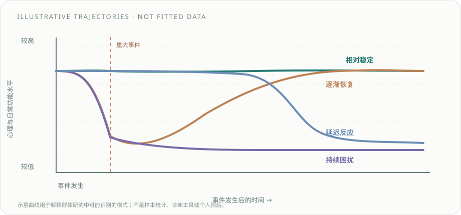

# 重大人生挫折后的心理重构：心气为什么会消失，又如何重新建立？

> **核心结论**：重大挫折后，一个人看起来像“换了个人”，不一定是意志力突然消失，也不能简单解释为“以前太天真”或“终于看透人生”。更准确的解释是：挫折可能同时切断资源、行动反馈、社会角色、关系支持与未来预期，使原有的心理—行为系统失去稳定条件。之后出现的反应存在多种轨迹；恢复不是单靠“想开一点”，而是重新获得安全、支持、可控行动和新的自我解释。

**研究状态：部分核验。** 本文是基于用户提供的网络文章问题意识、心理学理论、系统综述、元分析和官方健康资料形成的专题综合，不是临床诊断，也不是注册方案的系统综述。用户提供的原文未附作者、原始链接和发布日期，无法核验其传播来源；原文只作为研究问题的引子，不作为心理学证据。

## 摘要：所谓“心气”，其实不是一个单独的心理变量

人们常说一个人“没心气了”“被生活打垮了”“变得沉默了”。这些日常表达把许多不同变化压缩成了一个词：行动意愿下降、对未来悲观、对风险更谨慎、社交减少、情绪麻木、身份感动摇、对努力是否有用失去信心，甚至只是暂时把精力转向生存事务。

心理学并没有一个被普遍接受、可以直接等同于“心气”的单一标准变量。为了分析，本文把它拆成六个相互影响的维度：

1. **行动效能感**：我是否相信自己的行动能够产生影响？
2. **结果预期**：我是否认为未来仍存在值得投入的可能？
3. **能力感**：我是否觉得自己仍能完成某些有价值的事情？
4. **身份连续性**：遭遇失败或失去之后，我还能否回答“我是谁”？
5. **关系联结**：我是否仍拥有可以信任、求助和共同生活的人？
6. **身心资源**：我是否还有足够的睡眠、健康、时间、金钱与注意力来行动？

这六个维度不是量表，也不是经过验证的诊断模型，而是一张帮助读者避免把复杂处境误判成“意志薄弱”的分析地图。

## 一、为什么重大挫折会让一个人像是变了？

### 1. 挫折首先改变的可能是资源，而不是性格

重大失业、破产、亲人离世、家庭关系破裂、严重疾病或长期照护压力，影响的往往不止一件事。一个人可能同时失去收入、住房安全、日常秩序、社会身份、熟悉的关系、可预期的未来，以及用于处理问题的时间和精力。

Hobfoll 在 1989 年提出的资源保存理论（Conservation of Resources, COR）把压力理解为有价值资源遭遇实际损失、损失威胁，或投入资源却无法获得相应回报的反应。这里的资源既包括金钱、工作、住房和健康，也包括社会支持、地位、技能、时间与个人能量。[1]

这能解释一个常被忽略的事实：**同一件坏事，可能不是一次打击，而是一个资源损失链条的起点。**

例如，经营失败可能先带来债务和现金流压力；现金流压力又影响睡眠、家庭关系和判断质量；家庭冲突进一步减少支持；当事人于是更难寻找新工作或重启业务。心理压力与现实处境可能相互强化，而不是简单的“先想不开，后面才变糟”。

一项针对荷兰农业经营者的三波纵向研究发现，企业财务问题与心理困扰之间存在相互作用：财务问题会预测心理困扰，持续困扰又可能通过退出意向等路径与后续经营状况恶化相关。该研究对象是特定行业的经营者，不能直接推广到所有破产者，但它提示我们：心理变化与客观资源变化可能构成双向反馈。[2]

### 2. 第二层冲击：行动与结果之间的联系变得不再可信

一个人长期投入努力，通常会形成一套关于世界的经验判断：

- 学习之后，能力会提高；
- 工作之后，收入或地位会改善；
- 认真经营关系，通常能获得回应；
- 认真规划，能够降低未来的不确定性。

这些经验不是幼稚幻想，而是人类学习和行动的重要基础。问题在于，当重大事件让原有规则突然失效，个体可能开始怀疑：**我的行动到底还会不会改变结果？**

1978 年 Abramson、Seligman 与 Teasdale 对人类习得性无助理论进行了重要修订。他们指出，个体在感受到行动与结果之间缺乏联系后，会对原因作出解释；解释可以是内在或外在、稳定或不稳定、普遍或具体。不同解释会影响无助感被理解为短期还是长期、局部还是全面，以及它是否进一步损害自尊。[3]

这不是说遭遇挫折的人必然会形成习得性无助，也不是说一个人只要“换个归因方式”就能摆脱现实困境。它真正提示的是：一次失败可能被理解为“这件事没有成功”，也可能被扩大解释成“我做什么都不会成功”。后者更容易侵蚀未来行动。

### 3. 第三层冲击：身份和社会角色可能一起动摇

破产者失去的可能不只是资产，也包括“我是一个成功经营者”“我是家庭的经济支柱”这样的身份；失去亲人的人可能同时失去照护者、伴侣、子女或家庭成员的角色；家庭破裂也可能使人失去熟悉的生活结构和归属感。

一项 2025 年发表的社区样本研究（N=159）发现，童年逆境与成年抑郁、焦虑之间的关联，部分可由自我概念清晰度和自尊等变量解释。研究为身份受损与心理困扰之间的关系提供了线索，但样本较小，研究对象是童年逆境，不能据此断言成年人的一次破产或丧亲必然通过同样路径产生心理变化。[4]

因此，“人格坍塌与重组”可以作为描述体验的比喻，却不能当作所有重大挫折必经的、已经被证实的心理学阶段。

### 4. 这不是纯粹的“内心问题”

如果一个人仍然面对债务催收、居住不稳定、照护负担、歧视、暴力或长期失业，那么要求他“向内求”“重建信念”，可能是在忽略持续存在的外部压力。

真正有效的分析必须同时问两个问题：

- 这个人的心理系统发生了什么变化？
- 哪些现实条件仍在制造损失，阻止他恢复？

心理适应不是用意志力替代经济、法律、医疗和社会支持。很多时候，先减少现实威胁，比先要求当事人改变心态更重要。

## 二、挫折后的反应并不是一条统一的“堕落曲线”

### 1. 韧性、恢复、持续困扰与延迟反应

Bonanno 2004 年的综述强调，面对丧失或潜在创伤，人们并不只有“崩溃”或“恢复”两种结果；在某些研究中，许多人在事件后仍能维持相对稳定的功能。韧性（resilience）与恢复（recovery）不是同一个概念：前者强调功能相对稳定，后者则指经历明显困扰或功能下降后逐渐回升。[5]

Galatzer-Levy、Huang 与 Bonanno 对 54 项研究进行综述和统计评估，识别出韧性、恢复、持续困扰和延迟出现困扰等轨迹；该综述报告韧性是研究中最常见的轨迹，但研究间的事件类型、样本、测量时间和统计模型存在差异，平均比例不能被当作任何个人的命运预测。[6]

可以用下列四种模式帮助理解：

- **相对稳定**：经历事件后，痛苦可能存在，但日常功能总体保持。
- **逐渐恢复**：早期出现明显困扰，随后随着时间、支持和条件变化而改善。
- **持续困扰**：症状或功能受损长期存在，需要进一步评估和支持。
- **延迟反应**：早期表现相对稳定，后来才出现明显困扰；这类轨迹在不同事件和研究中并不总是稳定出现。

这些是群体研究中识别出的统计轨迹，不是四种固定人格，也不应被用来给个人贴标签。

### 2. 丧亲研究进一步说明：不能把“悲伤”理解为线性阶段

2026 年一项针对丧亲成年人的系统综述纳入 13 篇文章、12 项研究和 14 个轨迹分析。研究中平均约 55% 的样本被归入韧性轨迹、33% 被归入恢复轨迹、10% 被归入持续性高水平哀伤轨迹。作者同时指出，丧亲后的恢复轨迹可能比其他压力事件更常见，延迟性哀伤的证据有限。[7]

这些比例来自不同研究和模型的汇总，不是所有国家、所有亲属关系或所有丧亲者的固定比例。丧失伴侣、子女、父母或其他亲人，事件背景、经济条件、文化规范和社会支持都可能不同。

Stroebe 与 Schut 提出的哀伤双过程模型认为，丧亲者需要在两类压力源之间动态调整：一类是面向失去本身的压力，另一类是面向失去之后生活重建的压力，例如承担新角色、处理日常事务、重新安排关系和生活节奏。适应并不意味着持续沉浸在悲伤中，也不意味着强迫自己尽快忘记；在面对失去与暂时转向日常生活之间来回摆动，可能是适应过程的一部分。[8]

### 3. 轨迹图是概念示意，不是人生预测

图中的曲线只用于解释不同研究轨迹的含义，不是根据某一组样本拟合的真实数据。某个人在某个时间点看起来“没事”，并不能证明他已经恢复；某个人暂时无法工作，也不能据此断定他将长期失去行动能力。

## 三、重新审视原文提出的三种“心气来源”

原文把心气分为三类：由无知和顺境支撑、由悲情英雄主义支撑、以及经历重创后向内重建。这种分类有叙事感染力，但目前没有证据表明它是心理学界认可的三种类型，更不能据此把人分成高低层次。它更适合被改写为三种可能的心理机制。

### 1. 顺境反馈型：不是“无知”，而是行动信念过度依赖单一反馈

一个人过去努力就能获得好成绩，投入工作就能升职，认真经营关系就能获得回报。这样的经历可以形成真实的能力感和自我效能感，并不天然脆弱。

风险出现在：当一个人的自我价值几乎完全绑定于某一种成功结果，且缺少替代角色、支持网络和风险预案时，单次重大失败就可能被解释为“我整个人都失败了”。

**需要检验的问题不是他以前是否乐观，而是他的自我评价是否只依赖一条反馈通道。**

### 2. 英雄主义型：不是“坚持”有问题，而是坚持失去修正能力

有些人把不认输、绝不转向、绝不求助视为身份的一部分。即使原有目标已经不现实，仍然不断追加时间、金钱和健康成本，只为证明过去的选择没有错。

这可能表现为目标僵化、对失败信息的回避、把求助理解为羞耻，以及把“改变策略”误解为“否定自己”。

但必须保留反例：在长期项目、创业和照护责任中，坚持可能是合理选择。关键在于能否根据新证据调整目标、节奏和投入，而不是简单地把坚持称为英雄主义或把退出称为成熟。

### 3. 内在重建型：可能是心理灵活性，也可能是情绪麻木

原文所说的“向内求”，如果指的是不再让单一外部评价决定自我价值，重新识别价值、接受不可改变的部分，并在现实约束下继续行动，它与心理灵活性（psychological flexibility）的一些研究方向相近。

心理灵活性并不等于没有痛苦，而是能够接触当下经验，同时根据重要价值采取行动，而不是被某一种想法、情绪或身份完全控制。Macri 与 Rogge 对 67 项研究、共 9,123 名参与者进行系统综述和元分析，发现接纳与承诺疗法（ACT）相关干预能够改变多种心理灵活性/僵化指标，这些变化与心理困扰下降相关。[9]

但外表平静、减少社交、降低欲望，也可能来自疲惫、抑郁、创伤反应或情绪麻木。仅凭一个人不再谈宏图、不再争先，无法判断他已经成熟。

**真正需要观察的不是他看起来是否平静，而是他是否仍能感受、连接、选择，并进行有意义的行动。**

### 4. 三种机制可以同时出现，也可能随着时间变化

一个人可以一开始依赖外部反馈，随后陷入僵化坚持，再慢慢学会调整目标；也可能在一段时间内表现出平静，后来才发现自己其实是在回避痛苦。人的反应会随资源、关系、健康、时间和新的事件变化。

因此，本文不采纳“第一种人脆弱、第二种人愚蠢、第三种人更高级”的道德排序。它会把真实的痛苦变成对当事人的二次评判。

## 四、如何理解“心气重建”：从恢复控制到重新组织生活

下面提出一个用于分析和自我观察的七环节框架。它是跨理论的实践性综合，不是经过临床试验验证的标准治疗方案，也不是要求所有人按固定顺序完成的阶段任务。

### 1. 先处理现实威胁，恢复最低限度的安全

在讨论人生意义之前，先确认基本生活是否有保障：住房、饮食、医疗、债务、法律事务、照护责任和人身安全。仍在持续发生的损失，需要现实层面的处理与外部支持。

如果问题涉及债务、劳动争议、家暴、医疗或住房，应优先寻找相应的专业服务，不要把所有问题都转换成“心理建设”。

### 2. 把“不可改变的损失”与“仍可影响的部分”分开

习得性无助研究提醒我们，行动与结果之间的联系感很重要；但这不意味着所有结果都可控。更有用的做法是把问题分成：

- 当前无法改变的事实：已经发生的死亡、已经结束的关系、不可逆的损失；
- 可以影响但不能完全控制的事项：求职、治疗、协商、债务安排、家庭沟通；
- 可以直接决定的下一步：今天联系谁、整理哪份材料、完成哪件低风险任务。

一项基于 1,766 名中年及老年参与者日常压力记录的纵向研究发现，在同一个人身上，某天感受到的压力可控程度高于平常时，也更可能报告该压力源得到解决；研究报告的个体内关联 OR 为 1.66。它是日常压力情境中的观察性关联，不能证明“只要增加控制感就能解决重大人生危机”，但支持了一个谨慎判断：恢复可操作的小范围控制，可能有助于处理日常压力。[10]

### 3. 用小而真实的反馈重建能力感

不要要求一个刚经历重大损失的人立刻恢复过去的工作强度、社交能力或宏大目标。更现实的是选择低成本、可逆、可观察的行动：

- 完成一项具体事务，而不是一次性解决整个人生；
- 记录行动与结果，而不是只记录失败；
- 允许求助、休息和调整；
- 以连续的小反馈替代一次性证明自己。

这里的重点不是“每天进步一点”的口号，而是重新积累证据：在某些范围内，我的行动仍然能够产生影响。

### 4. 重建关系支持，而不是把独立误解为孤立

自我决定理论强调自主、胜任和关系联结等基本心理需要。2024 年一项元分析汇总 881 个独立样本、443,556 名参与者和 4,561 个效应量，发现他人对自主、胜任和关系需要的支持，与主观幸福感呈较强正相关，与表现呈小到中等程度的正相关。[11]

这并不意味着某种关系支持可以保证一个人走出危机，也不意味着所有家庭或朋友都适合成为支持来源。真正的支持应当尊重当事人的选择，避免羞辱、强迫、过度控制和“你应该振作”的道德要求。

### 5. 重新组织身份：不要让一次事件吞掉全部自我

可以把“我破产了”与“我这个人毫无价值”分开，把“我失去了伴侣”与“我不再有任何身份”分开，把“这段关系失败了”与“我永远不值得被爱”分开。

身份重建不是否认损失，而是承认一个人同时拥有多个角色、关系、能力和价值。过去的身份可能需要改变，但不必由一次事件来定义全部人生。

### 6. 用价值和灵活性替代“证明自己”的冲动

一个人可以继续追求事业，但不必用事业成败证明人格；可以珍惜亲密关系，但不必用他人的认可决定全部自我价值；可以继续努力，也可以在证据表明原路线不可行时改变策略。

ACT 的研究强调接纳、认知解离、当下觉察、价值澄清和承诺行动等过程。[9] 这类证据支持把“能否在痛苦存在时继续进行有价值的行动”作为重要观察维度，但不能把 ACT 简化为一句“想开一点”，也不能用一般性文章替代专业治疗。

### 7. 在面对失去与恢复生活之间允许自己摆动

对于丧亲者，双过程模型尤其强调在面向失去的哀伤与面向恢复生活的任务之间摆动。[8] 今天能够处理工作，不代表已经不再悲伤；明天再次难过，也不代表之前的努力全部归零。

对其他重大挫折，这一模型可以提供启发，但不应被当作适用于所有情境的通用定律。

## 五、三个常见场景：同样是“没心气”，实际机制可能不同

| 场景 | 可能发生的变化 | 不能轻易下的结论 |
|---|---|---|
| 亲人离世 | 依恋关系、家庭角色、日常秩序和未来想象发生变化 | 不应要求按固定时间“走出来” |
| 创业破产 | 资产、信用、身份、现金流与家庭安全感同时受到冲击 | 不能把所有谨慎都解释为懦弱，也不能只靠心态解决债务 |
| 家庭破裂 | 关系联结、居住安排、经济分工、对子女的责任和自我叙事改变 | 不应把减少社交直接等同于成熟或抑郁 |

这三类场景的共同点是可能出现多层资源损失；差异在于损失是否持续、是否可逆、是否存在法律和经济约束、当事人是否拥有安全关系与可用支持。

## 六、对原文最重要的三项修正

### 修正一：重大挫折不必然导致“人格坍塌”

研究显示人们在重大压力后的反应存在异质性。有人维持相对稳定，有人经历痛苦后恢复，有人持续受困，也有人在后来才出现明显反应。不能用单一叙事解释所有人。[5][6]

### 修正二：创伤后成长不是必然结果，更不是痛苦的价值证明

2019 年一项元分析纳入 122 项纵向研究、98,436 名参与者，使用前后测等独立指标检验重大生活事件后的变化。研究发现，自尊、人际关系和掌控感等部分维度可能出现正向变化，但没有发现负性生活事件普遍比正性生活事件带来更强成长的证据；在多数带对照组的研究中，事件组与对照组的变化并无显著差异。[12]

另一项对 804 名经历重大负性生活事件的中年参与者进行多波测量的研究发现，事后自评的“创伤后成长”并不能预测随后观察到的相应积极变化。[13]

因此，“经历重创后一定会变得更强大”不是证据支持的普遍规律。一个人不必因为没有从苦难中获得所谓成长而感到失败；能够得到帮助、恢复生活、保留关系和减少伤害，本身就有价值。

### 修正三：心理困扰不能被浪漫化为“通透”

抑郁、创伤相关症状、持续性哀伤和普通的低落或疲惫，需要区分。并非每一次重大挫折都符合 PTSD 的诊断暴露条件；美国退伍军人事务部国家 PTSD 中心对 DSM-5 标准的说明强调，PTSD 诊断需要特定类型的创伤暴露以及再体验、回避、负性认知/情绪、警觉与反应性等症状维度，并考虑持续时间和功能损害。[14]

美国国家心理健康研究所建议，若严重情绪症状持续两周或更久，或已经妨碍日常任务，应寻求专业帮助；若出现自伤或自杀想法，应立即获得紧急支持。[15] 两周不是个人自我诊断的唯一门槛，也不意味着症状未满两周就不需要帮助。

对于丧亲者，APA 的延长哀伤障碍资料也强调，诊断不仅涉及持续时间，还涉及显著痛苦、功能损害以及是否超出文化、社会或宗教规范；成人通常要求死亡至少发生一年。[16] 这不是要求每个人等满一年才求助，而是说明普通哀伤不能被简单病理化。

## 七、可用于现实观察的“心理重构检查表”

面对一个经历重大挫折、状态明显改变的人，先不要问“他为什么不振作”，可以按以下问题逐项观察：

1. **现实资源**：收入、住房、健康、债务和照护压力是否仍在持续？
2. **行动控制**：他是否认为自己的任何行动都不会改变结果？
3. **归因范围**：他是在评价某件事失败，还是把失败扩大成对整个人的否定？
4. **身份连续性**：他是否只剩下一个失去的角色来定义自己？
5. **关系支持**：是否有可信任的人可以提供实际帮助，而不只是劝说？
6. **身心状态**：睡眠、食欲、精力、注意力和日常功能是否持续恶化？
7. **行动灵活性**：他能否在坚持、暂停、求助和转向之间作出选择？
8. **时间变化**：状态是在改善、反复、持续恶化，还是出现新的延迟反应？

这份检查表用于提出更好的问题，不用于诊断他人，也不能替代当事人的自我表达。

## 结论：不是找回过去的自己，而是重新建立能继续生活的系统

一个人的“心气”并不是完全独立于外部世界、可以无限自我供能的燃料。它可能依赖现实资源、行动反馈、能力感、关系支持、身份连续性和未来预期共同维持。

重大挫折会使这些条件同时受到冲击。一个人因此变得沉默、谨慎、低调，可能是适应、哀伤、资源保护、风险重新评估，也可能是需要专业帮助的持续心理困扰。不能只凭外在姿态判断。

真正值得追问的不是“他为什么不再像从前那样有斗志”，而是：

- 他失去了哪些资源？
- 哪些行动—结果联系被破坏？
- 他还有哪些关系和现实支持？
- 哪些部分已经不可逆，哪些部分仍能重新安排？
- 他能否不再用一次失败定义整个人生？

**重建不一定意味着恢复过去那种高昂、张扬、不断向外证明自己的状态。它可能意味着更清楚地识别边界、更能接受不确定性、更愿意求助，也更有能力在痛苦仍然存在时，选择下一步值得做的事。**

这不是苦难自动带来的升华，而是资源、关系、时间、支持与行动共同作用下，仍有可能发生的适应过程。

## 参考文献与证据入口

1. Hobfoll, S. E. (1989). [Conservation of resources: A new attempt at conceptualizing stress](https://doi.org/10.1037/0003-066X.44.3.513). *American Psychologist*, 44(3), 513–524.
2. Gorgievski, M. J., Bakker, A. B., Schaufeli, W. B., van der Veen, H. B., & Giesen, C. W. M. (2010). [Financial problems and psychological distress: Investigating reciprocal effects among business owners](https://repub.eur.nl/pub/22671). *Journal of Occupational and Organizational Psychology*, 83(2), 513–530.
3. Abramson, L. Y., Seligman, M. E. P., & Teasdale, J. D. (1978). [Learned helplessness in humans: Critique and reformulation](https://ppc.sas.upenn.edu/sites/default/files/lhreformulation.pdf). *Journal of Abnormal Psychology*, 87(1), 49–74.
4. Sharratt, L., & Ridout, N. (2025). [Direct and indirect effects of childhood adversity on psychopathology: Investigating parallel mediation via self-concept clarity, self-esteem and intolerance of uncertainty](https://doi.org/10.1111/bjc.12523). *British Journal of Clinical Psychology*, 64(2), 539–552.
5. Bonanno, G. A. (2004). [Loss, trauma, and human resilience](https://doi.org/10.1037/0003-066X.59.1.20). *American Psychologist*, 59(1), 20–28.
6. Galatzer-Levy, I. R., Huang, S. H., & Bonanno, G. A. (2018). [Trajectories of resilience and dysfunction following potential trauma: A review and statistical evaluation](https://doi.org/10.1016/j.cpr.2018.05.008). *Clinical Psychology Review*, 63, 41–55.
7. Eisma, M. C., van Rhee, L., Gast, J. A., & Lenferink, L. I. M. (2026). [Trajectories of grief following bereavement: A systematic review](https://doi.org/10.1080/10615806.2026.2705416). *Anxiety, Stress, & Coping*. Published online 16 August 2026.
8. Stroebe, M., & Schut, H. (1999). [The dual process model of coping with bereavement: Rationale and description](https://doi.org/10.1080/074811899201046). *Death Studies*, 23(3), 197–224.
9. Macri, J. A., & Rogge, R. D. (2024). [Examining domains of psychological flexibility and inflexibility as treatment mechanisms in acceptance and commitment therapy](https://doi.org/10.1016/j.cpr.2024.102432). *Clinical Psychology Review*, 110, 102432.
10. Witzel, D. D., et al. (2025). [Daily association between perceived control and resolution of daily stressors strengthens across a decade of adulthood](https://doi.org/10.1038/s44271-025-00313-7). *Communications Psychology*, 3, 130.
11. Slemp, G. R., et al. (2024). [Interpersonal supports for basic psychological needs and their relations with motivation, well-being, and performance: A meta-analysis](https://doi.org/10.1037/pspi0000459). *Journal of Personality and Social Psychology*, 127(5), 1012–1037.
12. Mangelsdorf, J., Eid, M., & Luhmann, M. (2019). [Does growth require suffering? A systematic review and meta-analysis on genuine posttraumatic and postecstatic growth](https://doi.org/10.1037/bul0000173). *Psychological Bulletin*, 145(3), 302–338.
13. Gangel, M. J., et al. (2024). [Does perceived posttraumatic growth predict observed changes in current-standing and state posttraumatic growth?](https://doi.org/10.1177/21677026231182329). *Clinical Psychological Science*, 12(3).
14. U.S. Department of Veterans Affairs, National Center for PTSD. [PTSD and DSM-5](https://www.ptsd.va.gov/professional/treat/essentials/dsm5_ptsd.asp). Updated September 2026.
15. U.S. National Institute of Mental Health. [My Mental Health: Do I Need Help?](https://www.nimh.nih.gov/health/publications/my-mental-health-do-i-need-help). Revised 2025.
16. American Psychiatric Association. [Prolonged Grief Disorder](https://www.psychiatry.org/patients-families/prolonged-grief-disorder).

## 研究局限与后续问题

- 本文是针对明确问题的定向文献检索与综合，不是覆盖所有数据库、所有语言和所有研究设计的系统综述。
- 多数研究针对特定事件、国家或人群；创伤暴露、丧亲、童年逆境、失业和经营失败不能被视为同一种事件。
- 韧性轨迹的群体比例受样本、测量时间和统计模型影响，不适用于预测某个具体个体。
- 自我概念清晰度研究中有横断面设计和较小样本，因果方向仍需更强纵向证据。
- “心气”是日常语言，不是标准化心理学构念；本文提出的六维框架和重建环节属于解释性综合，尚未经过独立验证。
- 后续研究可进一步比较丧亲、家庭破裂、失业和破产情境中的资源损失、社会支持、行动控制和身份变化，避免将不同危机混为一谈。
